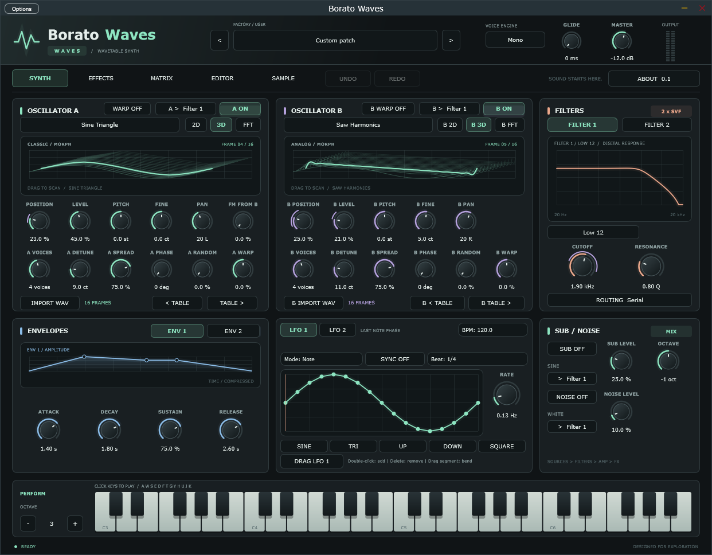

# Borato Waves

**Wavetable, sample, granular and spectral synthesis in one instrument.**
VST3 plugin and Standalone app, built in C++20 with JUCE.



Borato Waves takes you from a single wavetable frame to a frozen spectral pad without leaving the instrument. Load your own audio, slice it, scatter it into grains or resynthesize it. Then drive it all from one modulation matrix and four macros.

## Why producers use it

- **Two morphing wavetable oscillators.** Scan frames in 2D, 3D or FFT view, warp them, stack unison voices and cross-modulate with FM. Draw your own tables in the editor or import a WAV.
- **A real sampler inside.** Velocity layers with equal-power crossfades, up to 4 round-robin variants per zone, manual slices mapped to keys, up to 128 zones per bank and SFZ import.
- **Granular engine.** A fixed 32-grain pool per voice with density, size, scan, spread and ten grain windows. Turn any loop into a texture.
- **Spectral resynthesis.** Freeze a moment, scrub through it, change pitch without changing time, and stack two spectral transform stages. A spectral band filter with a wet/dry mix stays phase-aligned with the dry signal.
- **Modulation everywhere.** Two drawable LFOs, two envelopes, velocity and four macros route to 40 destinations through the matrix. Drag a source onto any dial to assign it.
- **Finishing built in.** Dual SVF filters in serial or parallel, plus drive, chorus, delay, reverb, EQ and compression.
- **74 factory presets, ready to play.** Basses, leads, pads, plucks, keys and arps. Three sampled instruments show off velocity layers, round robin and sliced grooves; three granular patches turn a sung glass choir, a tempo-locked figure and worn tape keys into clouds and pulses; three spectral patches freeze, stretch and bin-shift their sources. Every preset has four working macros.
- **Portable sessions.** Samples are embedded in the preset and project state, so a session opens on another machine without missing files.

## Building

Requires CMake 3.22 or later, a C++20 compiler, and development tools for your platform. On Windows, use a Visual Studio development environment.

The following commands download the pinned JUCE 9.0.4 revision:

```sh
cmake -S . -B build -DBORATOWAVE_FETCH_JUCE=ON -DBORATOWAVE_BUILD_TESTS=OFF
cmake --build build --config Release --target BoratoWave_VST3 BoratoWave_Standalone --parallel 2
```

Binaries are generated in `build/BoratoWave_artefacts/Release/`. For Linux setup, dependencies, Debug tests, and using a local JUCE checkout, see [BUILDING.md](BUILDING.md).

## Installation and usage

Copy the complete `Borato Waves.vst3` bundle to your platform's plugin directory:

| Platform | VST3 directory |
|---|---|
| Windows | `C:\Program Files\Common Files\VST3\` |
| macOS | `~/Library/Audio/Plug-Ins/VST3/` |
| Linux | `~/.vst3/` |

Rescan plugins in your DAW and load Borato Waves on a MIDI instrument track. In the Standalone application, configure your audio and MIDI devices before playing. The Windows Standalone supports MIDI input and ASIO.

## Automated builds

- **Pull requests to main/master:** VST3 compilation on Ubuntu.
- **Version tags matching `v*`:** VST3 and Standalone builds for Windows x64, Linux x64, macOS Apple Silicon, and macOS Intel, plus Debug tests on Ubuntu.
- Packages and checksums are collected in a draft release only after validation succeeds.

The tag must match the version declared in CMake. See [BUILDING.md](BUILDING.md) for the release procedure.

## Project status

Under active development. Windows packages are not commercially signed; macOS packages are ad-hoc signed but not notarized. Testing in real DAWs and with physical audio devices complements the automated tests.

See [SAMPLING.md](SAMPLING.md) for sample mapping, measurements and limits.
