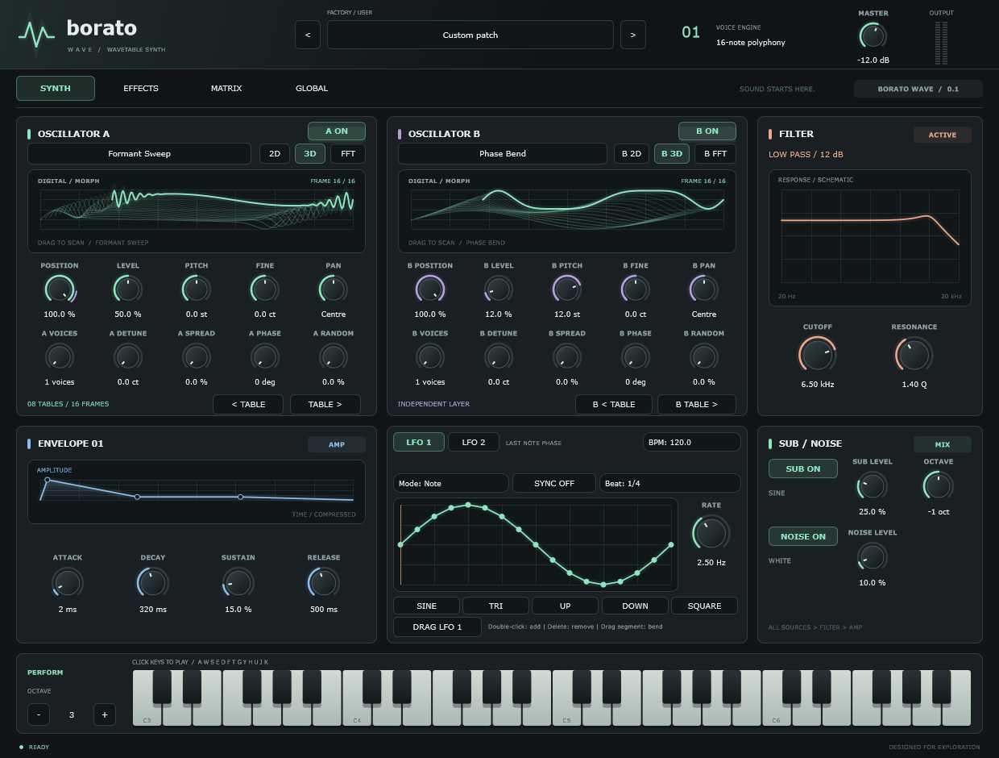

# Dual oscillators and source mixer

OSC A and B share the immutable eight-table bank but own their phase, table transition, position, pitch and gain. Each offers enable, coarse tuning (-24 to +24 semitones), fine tuning (-100 to +100 cents) and stereo pan. The browser targets the oscillator that opened it; waveform dragging, 2D/3D/FFT and host automation work independently.

The sub is a sine source at octave -2, -1 or 0. Noise is per-voice white noise from a local xorshift generator. Both have enable and level controls. MIDI pitch bend spans +/-2 semitones for A, B and sub, including the wheel position at note-on.

## Signal and lifecycle

`A + B + sub + noise -> stereo low-pass -> ADSR x velocity -> master`

The mixer uses equal-power pan scaled to unity per channel at centre, preserving the former A level. Mono averages left/right. Sub and noise are centred. Summing is additive; master level controls headroom, and there is no limiter. Factory patches now demonstrate B layering, detuned stereo, sub and subtle noise; Init resets all source parameters.

Enable/level, position, tuning, pan, resonance and bend use 20 ms ramps. Tables retain 15 ms phase-preserving transitions. Stable pitch/pan coefficients are cached. Filters and table readers are prepared before rendering; new source rendering adds no allocation, locking, file access or GUI calls. JUCE's existing synthesiser/keyboard synchronization remains in the surrounding engine.

Each source selects bandwidth from its actual frequency. Fundamentals fade over the last 5% below Nyquist and are silent above it. A valid transposed sub can still play when A/B are outside the representable band. Phase wraps remain bounded. Discrete mip transitions and rapid frame modulation still warrant future spectral-quality work; this is not an alias-free modulation claim.

## Persistence and validation

Existing IDs and ordering are preserved; 16 source parameters are appended. State loading fills missing IDs from declared defaults, so legacy sessions restore A on and B/sub/noise off. Factory matching includes every new source parameter.

`test_sources` checks A/B isolation and equivalence, stereo extremes, coarse/fine tuning, bend, additive mixing, sub frequency, noise DC, Nyquist behavior, automation at 8–192 kHz and state migration. `test_interface` checks independent B browser/drag gestures, enable controls, patch reset, restored labels and actual editor rendering. Run Debug assertions alongside `test_wavetable`.

The implementation is original. [Fresh Ghidra findings](OSCILLATOR_RESEARCH.md) informed architecture, not exact Serum algorithms. Hardware listening and DAW automation remain manual validation.

A/B now also provide eight-lane unison, detune, spread, phase/randomness and matrix destinations; see [MODULATION.md](MODULATION.md) for current modulation and lane behavior.

## Sample source

The **SAMPLE** page plays an imported recording as a fourth per-voice source into Filter 1. This is separate from IMPORT WAV, which slices audio into wavetable frames. Its parameters are appended: `sampleOn`, `sampleLevel`, `samplePitch` (±24 st), `sampleStart`, `sampleEnd` and `sampleLoop`. All are automatable, and states without them load the source off.

- **Pitch:** MIDI note 60 plays the file at its own pitch, corrected for the file's sample rate. Note pitch, bend, glide and `samplePitch` transpose it. Reading uses cubic interpolation. There is no anti-aliasing when playing far above the root.
- **Region:** start and end are fractions of the file, in either order, at least 64 frames apart.
- **Loop:** the last 10 ms of each pass (at most half the region) crossfades into the audio one period earlier, so a wrap never steps.
- **One-shot:** the last 10 ms fades out and the voice then stays silent until note-off.
- **Moving start/end:** a change takes effect at the next loop pass (one-shot: the next note), so automation never jumps the read head. A pass ends no sooner than one crossfade after a wrap.
- **File reference:** state and presets store the file's absolute path, not the audio. A missing or unreadable file restores everything else, plays silence, shows **MISSING** with the path, and keeps the reference when saved again. Relinking the file at that path restores the sound. Factory presets clear the sample.
- **Limits:** `loadSample` decodes on the calling thread to a mono mixdown. Files over 2^22 frames (16 MB, about 95 s at 44.1 kHz) or under 64 frames are refused, and the loaded sample stays.
- **Replacing the sample during notes:** the new sample is published like a user table. Each sounding voice fades the old one out over 5 ms while the new one fades in from its start. A second replacement within that fade waits for it to finish.
- **Freeing replaced audio:** after each block the processor tells the slot once every voice has settled on the current sample. A replaced sample is then freed at the next publish. User tables now use the same rule.

`test_sample` covers:

- pitch at 44.1/48/96 kHz;
- a loop whose period does not divide the region, at three pitches and rates (no step above 1.5× the sine's own slope);
- the one-shot fade;
- start/end automation;
- a mid-cycle swap and the release of the old audio;
- a missing file and relinking it;
- legacy state and the factory reset;
- the frame limit, unreadable files and the stereo mixdown.

Removing the loop crossfade, the swap fade or the settle report each makes it fail. Benchmark profiles `sample16` and `extreme_sample` measure the per-voice cost; see [CPU_PROFILING.md](CPU_PROFILING.md).

